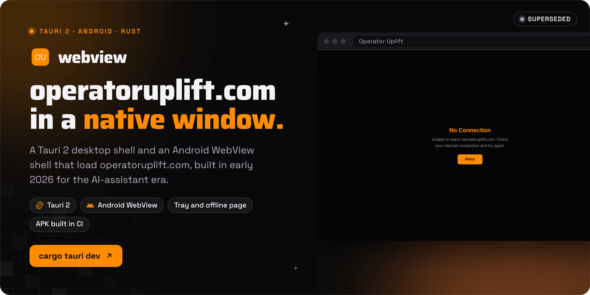
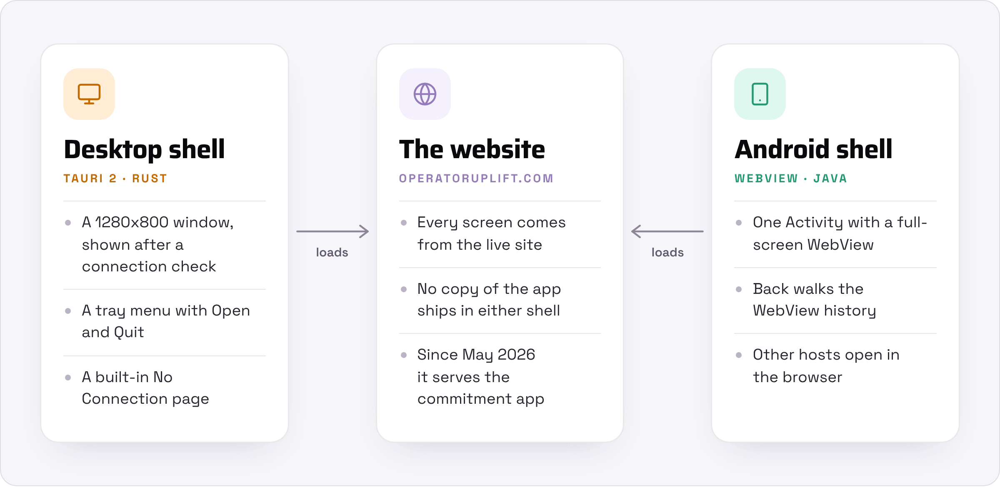

<div align="center">



<br><br>

<a href="#run-it-locally"></a>&nbsp;&nbsp;
<a href="https://github.com/operatoruplift/webview/actions/workflows/build-apk.yml"></a>&nbsp;&nbsp;
<a href="https://operatoruplift.com"></a>

<br><br>

<a href="https://github.com/operatoruplift/webview/actions/workflows/build-apk.yml"></a>


<a href="LICENSE"></a>

<h3>The desktop and Android shells from Operator Uplift's AI-assistant era.</h3>

<b>Launch</b> &nbsp;→&nbsp; <b>Check</b> &nbsp;→&nbsp; <b>Load</b> &nbsp;→&nbsp; <b>Show</b>

<br>

<a href="#how-it-works">How it works</a> &nbsp;·&nbsp;
<a href="#status">Status</a> &nbsp;·&nbsp;
<a href="#where-it-fit">Where it fit</a> &nbsp;·&nbsp;
<a href="#run-it-locally">Run it locally</a>

</div>

<br>

**webview holds the two app shells Operator Uplift used to put operatoruplift.com on a desktop and a phone.** The desktop shell is a Tauri 2 app in Rust that opens the site in a native window, with a tray menu and an offline page. The Android shell is a single WebView Activity that loads the site and sends other hosts to the browser. Neither shell contains product code, and neither has changed since 1 April 2026, seven weeks before the 22 May 2026 pivot to commitment infrastructure. The Android app Operator Uplift ships today is built from the private website repository instead.

The window in the banner is the desktop shell's built-in offline page, rendered from the HTML in `src-tauri/src/main.rs` on 30 October 2026. Online, the same window shows operatoruplift.com itself.

The Android project began as slymax's WebView template for Android Studio, and its history from 2020 to 2022 is kept here, which is why GitHub still calls this repo a template. It was pointed at operatoruplift.com on 20 January 2026, and the Tauri shell arrived on 1 April 2026 in [pull request 1](https://github.com/operatoruplift/webview/pull/1).

<br>

## How it works

<picture>
  <source media="(prefers-color-scheme: dark)" srcset="docs/readme/flow-dark.png">
  
</picture>

<table>
  <tr valign="top">
    <td width="33%"><b>No white flash</b><br><sub>The window starts hidden on a <code>#050508</code> background, tries a TCP connection to <code>www.operatoruplift.com:443</code> for up to five seconds, then shows itself 300 ms later.</sub></td>
    <td width="33%"><b>An offline page, not an error</b><br><sub>If that check fails, the shell opens <code>about:blank</code> and writes its own No Connection page, whose Retry button reloads the site.</sub></td>
    <td width="33%"><b>Desktop detection</b><br><sub>After the check, the shell runs <code>window.__TAURI__ = true</code> in the page, so the site can tell it is inside the desktop app.</sub></td>
  </tr>
  <tr valign="top">
    <td><b>A tray icon</b><br><sub>Open shows and focuses the window, Quit Operator Uplift exits, and clicking the icon restores the window.</sub></td>
    <td><b>macOS manners</b><br><sub>Closing the window, with Cmd+W or the close button, hides it instead of quitting. Cmd+Q in the default app menu, or Quit in the tray, exits.</sub></td>
    <td><b>Android navigation</b><br><sub>JavaScript is on, Back walks the WebView history, and a link to any host outside operatoruplift.com opens in the default browser.</sub></td>
  </tr>
</table>

<p align="center"><sub>Tauri 2.10 · Rust 2021 edition · tokio · tauri-plugin-shell · Android WebView in Java · Android Gradle Plugin 8.7.3 · Gradle 8.10.2 · compile and target SDK 34, minimum SDK 21 · GitHub Actions with JDK 17</sub></p>

<br>

## Status

<table>
  <tr valign="top">
    <td width="16%" align="center"></td>
    <td>The Tauri desktop shell. Until 30 October 2026 it did not compile: <code>main.rs</code> passed a <code>WebviewUrl</code> where Tauri 2 expects a <code>Url</code>. With that fixed, <code>cargo check --locked</code> passes (checked on Linux with stub <code>pkg-config</code> entries for GTK and WebKitGTK, so the code was type-checked but not linked or run). No installer has been built, signed or released, and the planned second phase, connecting to the core runtime on <code>localhost:3001</code>, was never started.</td>
    <td width="22%"><a href="src-tauri/src/main.rs">main.rs</a></td>
  </tr>
  <tr valign="top">
    <td align="center"></td>
    <td>The Android shell. The Build Android APK workflow passed on its last run, on 1 April 2026, and its APK has since expired. Each run signs with a keystore generated in that run, so the APKs suit testing, not a store. The app still carries the template's name, WebView App, and its green globe icon.</td>
    <td><a href="https://github.com/operatoruplift/webview/actions/runs/23857839292">Last APK run</a></td>
  </tr>
</table>

<br>

## Where it fit

Operator Uplift was first pitched as AI for your inbox and calendar, built across several repos. This one put the website on desktops and phones.

<table>
  <tr>
    <th width="30%" align="left">Repo</th>
    <th width="70%" align="left">Role in the AI-assistant platform</th>
  </tr>
  <tr valign="top">
    <td><b>webview</b> (this repo)</td>
    <td>The Tauri desktop shell and an Android WebView shell, both loading operatoruplift.com.</td>
  </tr>
  <tr valign="top">
    <td><a href="https://github.com/operatoruplift/UI"><b>UI</b></a></td>
    <td>Shared React components and design tokens. Before April 2026, the Uplift Assistant Electron desktop app.</td>
  </tr>
  <tr valign="top">
    <td><b>developer_console</b> (private)</td>
    <td>A Vite and React console for agent builders: prompt playground, debugger, logs, memory and MCP pages.</td>
  </tr>
  <tr valign="top">
    <td><b>core</b> (private)</td>
    <td>The agent runtime that the console and this desktop shell were meant to reach on <code>localhost:3001</code>.</td>
  </tr>
  <tr valign="top">
    <td><b>calendar_agent</b>, <b>x402-agent</b>, <b>project_space</b> (private)</td>
    <td>Google Calendar tools, x402 agent payments on Solana, and an internal project tracker.</td>
  </tr>
  <tr valign="top">
    <td><a href="https://github.com/operatoruplift/uplift-ai-chatbot"><b>uplift-ai-chatbot</b></a></td>
    <td>A deployment of Vercel's Chat SDK template.</td>
  </tr>
</table>

<br>

## Run it locally

<table>
  <tr valign="top">
    <td width="33%"><b>Prerequisites</b><br><sub>Rust stable (checked with 1.97.0) and the Tauri 2 CLI. On Linux, the WebKitGTK 4.1 and GTK 3 development packages. For Android, JDK 17 and an Android SDK with platform 34.</sub></td>
    <td width="33%"><b>Read first</b><br><sub>The <a href="https://v2.tauri.app/start/prerequisites/">Tauri prerequisites</a> for your OS, and <a href="CLAUDE.md">CLAUDE.md</a>, the brief the desktop shell was built from.</sub></td>
    <td width="33%"><b>What the checks prove</b><br><sub>There are no tests. The APK workflow proves the Android project assembles. Nothing in CI builds the desktop shell; <code>cargo check</code> is the only check it has had.</sub></td>
  </tr>
</table>

### 1. The desktop shell

```bash
cargo install tauri-cli --version "^2"   # the Tauri 2 CLI
cargo tauri dev                          # opens the window on https://www.operatoruplift.com
cargo tauri build                        # installers in src-tauri/target/release/bundle/
```

There is no local frontend: `devUrl` and the window URL both point at the live site, and `dist/index.html` only redirects there. Bundle targets are set to `all`, so a build makes every bundle format Tauri supports on your OS, such as a .dmg on macOS, an NSIS installer on Windows or an .AppImage on Linux.

To type-check without building, run `cargo check --manifest-path src-tauri/Cargo.toml --locked`.

### 2. The Android shell

```bash
./gradlew assembleDebug   # a debug APK in app/build/outputs/apk/debug/
```

The [workflow](.github/workflows/build-apk.yml) builds a signed release instead. On every push to `master`, or when run by hand, it generates `release.keystore` with `keytool`, sets the variables below and runs `./gradlew assembleRelease`.

| Variable | Default in `app/build.gradle` | Used for |
|---|---|---|
| `KEYSTORE_FILE` | `release.keystore`, relative to `app/` | The release keystore |
| `KEYSTORE_PASSWORD` | `android` | The keystore password |
| `KEY_ALIAS` | `key0` | The key alias |
| `KEY_PASSWORD` | `android` | The key password |

<details>
<summary><b>Pointing the shells at another site</b></summary>
<br>

| File | What to change |
|---|---|
| `src-tauri/tauri.conf.json` | `build.devUrl`, `app.windows[0].url` and `bundle.macOS.exceptionDomain` |
| `src-tauri/src/main.rs` | The host in `check_connectivity` and the text of `OFFLINE_HTML` |
| `dist/index.html` | The redirect target |
| `app/src/main/java/com/example/app/MainActivity.java` | The URL in `mWebView.loadUrl(...)` |
| `app/src/main/java/com/example/app/MyWebViewClient.java` | `hostname`, which decides which links stay in the app |

To ship local files on Android instead, put them in `app/src/main/assets/` and switch `MainActivity` to the commented `file:///android_asset/index.html` line.

</details>

<details>
<summary><b>Repository layout</b></summary>
<br>

| Path | Contents |
|---|---|
| `src-tauri/src/main.rs` | The desktop shell: tray, connection check, offline page and window events |
| `src-tauri/tauri.conf.json` | Window size and color, the site URL, bundle targets and icons |
| `src-tauri/capabilities/default.json` | Permissions for the main window: `core:default` and `shell:allow-open` |
| `dist/index.html` | The bundled fallback page, which redirects to the site |
| `app/` | The Android app: `MainActivity`, `MyWebViewClient`, the manifest and resources |
| `build.gradle`, `settings.gradle`, `gradle/`, `gradlew` | The Gradle build for the Android app |
| `.github/workflows/build-apk.yml` | Builds a signed release APK |
| `CLAUDE.md` | The brief the desktop shell was built from |

</details>

<br>

<p align="center"><sub>MIT licensed, copyright 2026 Operator Uplift (see <a href="LICENSE">LICENSE</a>); dependencies keep their own licenses.</sub></p>

<p align="center"><sub>Built by <a href="https://rvaclassic.xyz">Matt Sim</a>, founder of <a href="https://operatoruplift.com">Operator Uplift</a>. More builds at <a href="https://github.com/operatoruplift">github.com/operatoruplift</a>. Want one built for your product? <a href="https://cal.com/rvaclassic/15min">Book a 15-minute call</a>.</sub></p>
